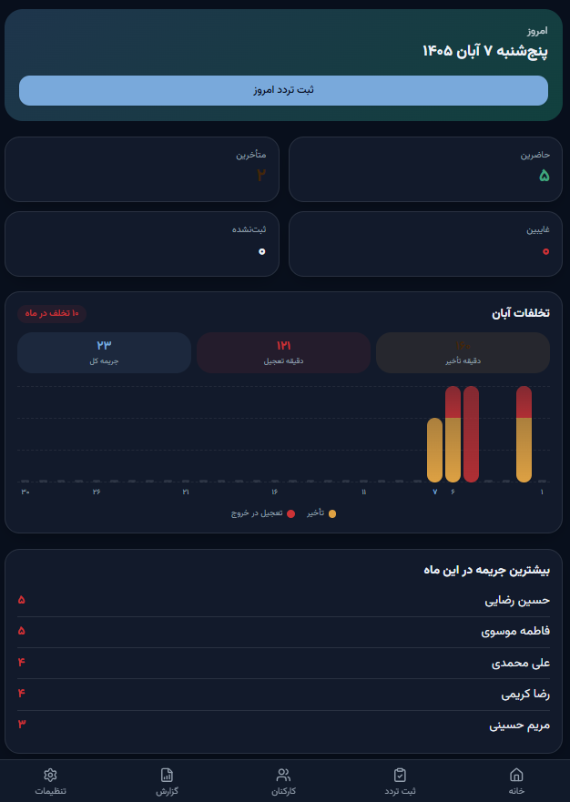
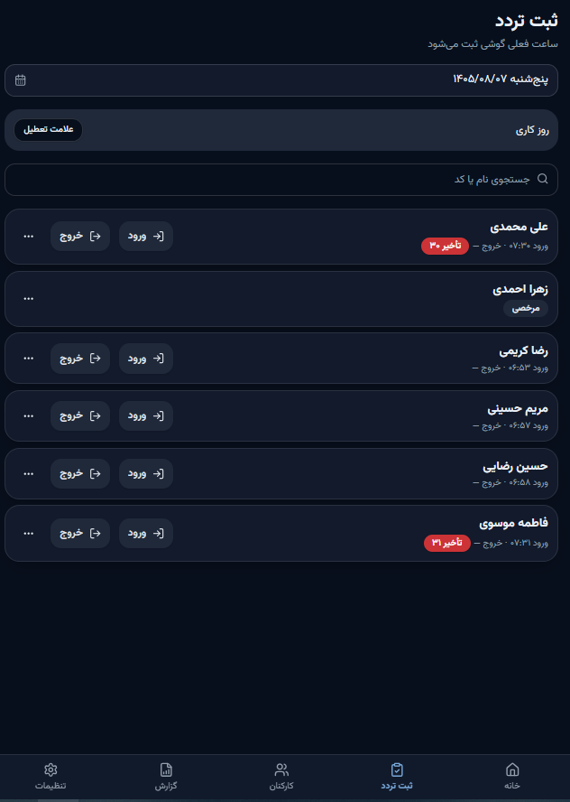
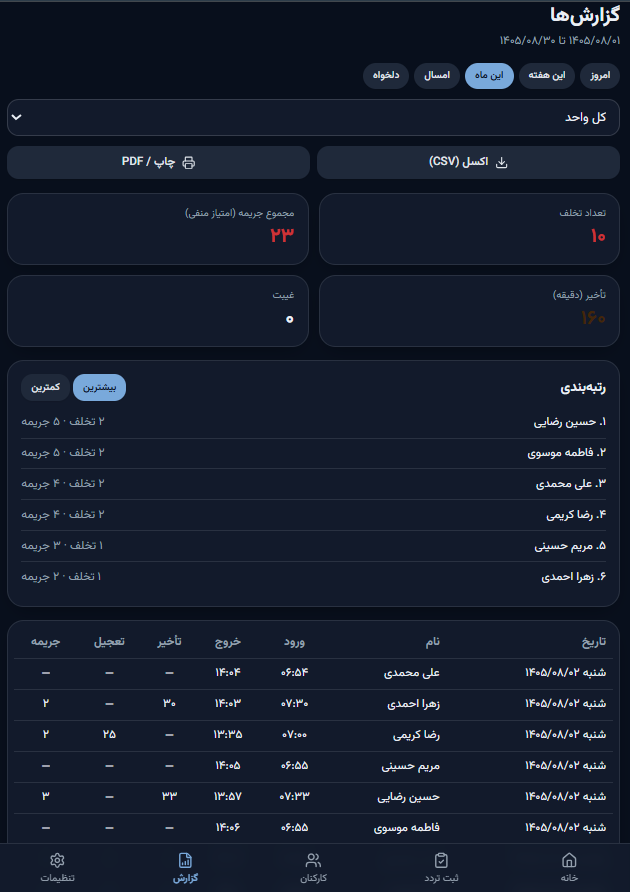
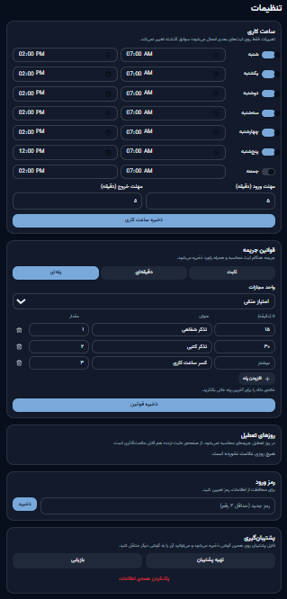

# Employee Attendance Tracking (PWA)

A Persian-language, mobile-first web app for recording employee check-in/check-out times and automatically calculating lateness, early departure, and penalties. It runs in the browser on phones and desktops, and can be installed on the home screen like a native app.

**All data is stored locally on the user's device. Nothing is sent to a server.**

---

## Screenshots

| Dashboard | Attendance | Employees |
|---|---|---|
|  |  |  |

| Reports | Settings |
|---|---|
|  |  |

## Features

- **One-tap attendance:** record daily check-in and check-out for each employee
- **Persian (Jalali) calendar:** fully Jalali dates with Persian numerals
- **Automatic calculations:** lateness, early departure, and penalties
- **Flexible penalty rules:**
  - *Fixed:* the same penalty for every violation
  - *Per minute:* penalty = minutes × rate
  - *Tiered:* e.g. verbal warning up to 15 min, written warning up to 30 min, working-time deduction beyond that
- **Configurable penalty unit:** negative points, deducted work minutes, or warnings
- **Dashboard:** monthly violations chart, summary cards, and penalty ranking
- **Reports:** monthly or custom date range, with CSV (Excel) export and print/PDF
- **Employee file:** full history over any date range, statistics, and the ability to forgive a violation with a recorded reason
- **PIN lock:** a simple on-device lock screen (a convenience lock, not encryption)
- **Backup & restore:** export and import all data as a JSON file
- **Installable (PWA):** add to the home screen on mobile (web manifest only; no service worker or offline caching)

---

## Tech Stack

| Technology | Purpose |
|---|---|
| **TypeScript** | Main language, with strict type checking |
| **React 19** | UI library |
| **TanStack Start / TanStack Router** | App framework and routing |
| **Tailwind CSS v4** | Styling, RTL layout |
| **shadcn/ui + Radix** | UI components (buttons, dialogs, calendar, etc.) |
| **Lucide** | Icons |
| **Vite 7** | Build tool and dev server |
| **Vitest** | Automated tests (13 tests: Jalali calendar, lateness, penalty rules, routing) |
| **localStorage** | On-device data storage |
| **PWA Manifest** | Installable on the home screen |
| **Jalaali algorithm** | Gregorian-to-Jalali date conversion, implemented in the codebase |

---

## Project Structure

```
src/
├── routes/          App pages (each file = one page)
├── components/
│   ├── app/         App-specific components
│   └── ui/          Base UI components (button, card, dialog, ...)
├── lib/             Core logic (calculations and storage)
├── hooks/           React helper hooks
└── test/            Automated tests (Vitest)
public/              Icons and PWA manifest
```

### Core logic (`src/lib/`)

- **`jalali.ts`**: Jalali calendar utilities: Gregorian-to-Jalali conversion, month length, leap years, weekday, date arithmetic, Persian/Latin digit conversion, and date formatting. Each date is stored as a sortable key such as `1405-08-03`.
- **`penalty.ts`**: `calcLate`, `calcEarly`, and `penaltyFor` implement lateness, early-departure, and fixed / per-minute / tiered penalty rules.
- **`store.ts`**: data management on top of `localStorage`: record creation with automatic calculations (`computeRecord`), validation such as duplicate records or check-out before check-in (`validateRecord`), forgiving violations (`forgiveRecord`), backup/restore, statistics (`summarize`), and sample data generation (`sampleDB`).

### Pages (`src/routes/`)

| File | Page | Purpose |
|---|---|---|
| `index.tsx` | Dashboard | Today's status, monthly violations chart, summary cards, penalty ranking |
| `today.tsx` | Attendance | One-tap check-in/out, name search, holiday marking |
| `employees.index.tsx` | Employees | List, add, edit, delete, activate/deactivate |
| `employees.$id.tsx` | Employee file | History, statistics, forgive violations |
| `reports.tsx` | Reports | Monthly/custom reports, CSV export, print/PDF |
| `settings.tsx` | Settings | Work hours, penalty rules, holidays, PIN, backup |
| `__root.tsx` | Root layout | Shared layout, Vazirmatn font, RTL |

---

## Architecture Notes

- **Local-first, no server:** there is no backend database. Data lives on the user's device, and moving between devices is done with a JSON backup file.
- **Stored records are the source of truth:** changing penalty rules does not rewrite past records.
- **Sortable date keys:** Jalali dates are stored as Latin-digit keys, which keeps comparison and reporting fast and error-free.
- **Absence, leave, and mission days** carry no penalty, and holidays are exempt.
- **Strict TypeScript:** `noUncheckedIndexedAccess` and `exactOptionalPropertyTypes` are enabled to prevent hidden bugs.
- **Fully Persian, right-to-left UI** with the Vazirmatn font and Persian numerals.

---

## Getting Started

The repository includes a `bun.lock` file, so Bun is the primary package manager; npm works too.

```bash
# Clone the repository
git clone https://github.com/<MahdiGh1892>/<attendance-tracker>.git
cd <attendance-tracker>

# Install dependencies (use `npm install` if you prefer npm)
bun install

# Start the development server
bun run dev        # or: npm run dev

# Run the tests
bun run test       # or: npm test

# Lint and build
bun run lint
bun run build
```

---

## Tests

13 automated tests run with Vitest:

- `src/test/rules.test.ts` (12 tests): Jalali calendar conversion and leap years, lateness and early-departure calculation, fixed / per-minute / tiered penalties, leave and holiday exemptions, and check-out-before-check-in validation
- `src/test/app-routing.test.tsx` (1 test): the home route resolves to a page

---

## License

[MIT](LICENSE)

---

## Author

**Mehdi Ghasemi**, Engineer & Data Analyst
[LinkedIn](https://www.linkedin.com/in/mehdi-ghasemi99/)
